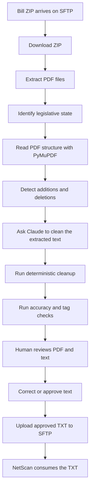

# Pending Legislation
## Technical and Beginner-Friendly Handoff Guide

**Document purpose:** Help a new owner understand, operate, troubleshoot, and safely maintain the Pending Legislation project.

**Audience:**

- New engineers taking ownership of the project
- Support, operations, QA, and product users
- Anyone who needs to understand what the system does without reading the source code

**Project purpose:** Convert legislative bill PDFs into accurate plain-text files with markup showing added and deleted language, validate those files, allow human review, and upload approved files to the downstream NetScan system.

---

## 1. Executive Summary

The Pending Legislation application receives legislative bill PDFs from an internal SFTP server. It extracts the printed text, identifies formatting that represents added or deleted legislative language, cleans away unwanted PDF artifacts, checks the result for accuracy, and presents the output to a human reviewer.

The approved text is then uploaded to another SFTP directory for downstream processing.

The most important business rule is:

> This is a transcription and formatting-preservation system, not a summarization or proofreading system.

The output must preserve:

- Every printed word
- Original capitalization
- Original punctuation
- Original document order
- Relevant paragraph and section structure
- Formatting that represents legislative additions or deletions

The output uses two fixed markup formats. The characters are defined by the NetScan rulebook and must not be changed:

```text
[A>new or added language<A]
[D>old or deleted language<D]
```

`[A> ... <A]` is the **addition/new-language tag**. It is used for text that the state rules identify as added language. Depending on the state, that may be shown by an underline, bold text, italic text, all-capital text, brackets, or another documented convention.

`[D> ... <D]` is the **deletion tag**. It is normally used for text shown with a strikethrough, but some states also use bracketed text or another state-specific convention for deleted language.

The tags do not mean that the software should rewrite the bill. They only mark the formatting already present in the PDF. The state-specific configuration determines which visual formatting is eligible for each tag.

The application uses a combination of deterministic PDF analysis and Claude LLM processing. The LLM is useful for cleaning and interpreting difficult layouts, but it is surrounded by deterministic checks because an LLM can accidentally omit, duplicate, reorder, or change text.

---

## 2. The Complete Process in Plain English



### Business explanation

1. A ZIP file containing one or more bills arrives.
2. The system downloads it and extracts the PDFs.
3. The system identifies the state from the filename or document.
4. The PDF is read and converted to text.
5. Underlines, strikethroughs, bold text, italics, and other state-specific conventions are interpreted.
6. Claude cleans the text while following rules for that state.
7. Automated checks look for missing text, malformed markup, and common extraction errors.
8. A human compares the result with the original PDF.
9. The human edits or approves the result.
10. The approved `.txt` file is uploaded to the downstream SFTP location.

### Engineering explanation

The current primary processing path is a hybrid pipeline:

```text
PDF
  -> PyMuPDF geometric extraction
  -> tagged raw text
  -> state-specific cleanup prompt
  -> Claude chunk cleaning
  -> chunk merge
  -> deterministic post-processing
  -> integrity and accuracy reports
  -> human review
  -> SFTP upload
```

---

## 3. Repository Map

| Location | What it does |
|---|---|
| `pipeline_runner.py` | Root-level batch pipeline runner |
| `app/pipeline_runner.py` | Application/deployment-oriented pipeline runner with validation logic |
| `ftp_download.py` | Downloads files from the input SFTP directory |
| `ftp_upload.py` | Uploads text files to the output SFTP directory |
| `app/streamlit_app.py` | Main Streamlit user interface and processing orchestration |
| `app/session_manager.py` | Creates and tracks temporary user sessions |
| `app/pymupdf_extractor.py` | Extracts PDF text and detects formatting using PDF geometry |
| `Opus4.6/Claude_Opus_4.6_Test.py` | Claude authentication, hybrid conversion, cleanup, and post-processing |
| `Opus4.6/conversion_prompts.md` | General prompt templates and transcription rules |
| `Opus4.6/netscan_state_template.json` | State-specific conversion rules |
| `Opus4.6/pymupdf_compare.py` | Compares detected PDF formatting against output tags |
| `app/content_accuracy_checker.py` | Compares source-derived text and final text |
| `app/extraction_validator.py` | Detects known extraction problems without modifying output |
| `app/validation_review_inline.py` | Displays audit and review information in Streamlit |
| `tests/` | Unit tests, regression tests, and PDF fixture tests |
| `Dockerfile` | Builds the Streamlit container |
| `requirements.txt` | Python dependencies |
| `DEPLOYMENT_COMMANDS_2026-06-11.md` | Deployment notes for building and publishing the container |
| `README.md` | General project documentation, partly historical |
| `PIPELINE_FLOW.md` | End-to-end pipeline description |

### Important repository observation

There are two pipeline runner files. They are similar but not identical. The application copy contains additional validation behavior, while the root-level copy is a simpler runner.

Before changing the pipeline, confirm which runner is used in each environment. The Dockerfile copies the `app/` folder into the container, so production may use `app/pipeline_runner.py` rather than the root-level file.

---

## 4. Input, Working Files, and Output Files

### SFTP input location

The expected input directory is:

```text
/apps/Codes/MP2/LandingStrips/LCPR/ftp/out
```

Typical ZIP filenames look like:

```text
NC_<GUID>_keying.zip
DE_<GUID>_keying.zip
OH_<GUID>_keying.zip
```

The first part before the underscore is normally the two-letter state code.

### Local working directories

The project normally uses a structure similar to:

```text
tmp/
├── pending_downloads/
│   └── NC_<GUID>_keying.zip
├── pending_processing/
│   ├── .processed_files.json
│   └── 09082026/
│       └── NC_20260908_143000_<zip-name>/
│           ├── input/
│           │   └── bill.pdf
│           └── output/
│               ├── bill.txt
│               ├── bill_hybrid_raw.txt
│               ├── bill_hybrid_precleaned.txt
│               ├── bill_integrity_validation.json
│               ├── bill_content_accuracy.json
│               ├── bill_clean_diff.txt
│               └── bill_hybrid_chunks.txt
└── sessions/
    └── <UUID>/
        ├── input/
        ├── output/
        └── logs/
```

### What the important files mean

| File | Meaning |
|---|---|
| `bill.pdf` | Original source document |
| `bill.txt` | Converted text intended for review or upload |
| `*_hybrid_raw.txt` | Text extracted directly from the PDF before LLM cleanup |
| `*_hybrid_precleaned.txt` | Text prepared as input to the LLM |
| `*_integrity_validation.json` | Tag and content integrity results |
| `*_content_accuracy.json` | Comparison between source-derived text and final text |
| `*_clean_diff.txt` | Description of changes made during LLM cleanup |
| `*_hybrid_chunks.txt` | Raw and cleaned text for each LLM chunk |
| `.processed_files.json` | Local record used to avoid repeat processing |

Do not delete working folders or `.processed_files.json` casually. They may be needed for audit, reprocessing decisions, or duplicate-upload prevention.

### SFTP output location

Approved text files are uploaded to:

```text
/apps/Codes/MP2/LandingStrips/LCPR/ftp/keyed
```

Downstream systems are expected to consume files from that location.

---

## 5. Conversion Engine Details

### 5.1 PyMuPDF extraction

`app/pymupdf_extractor.py` is responsible for reading the PDF at a low level.

It uses information such as:

- Character bounding boxes
- Text span positions
- PDF annotations
- Horizontal drawing lines
- Font names
- Font sizes
- Relative positions of text blocks
- Page boundaries

This matters because PDF text is not always stored in the same order that a person sees it. For example, an amount may visually appear after a label but be emitted before the label by the PDF internals.

The extractor includes specialized logic for problems such as:

- Underlines mistaken for page separators
- Strikethrough lines crossing only part of a word
- Text split across PDF spans
- Table columns collapsing together
- Superscript footnote references
- Hidden OCR layers
- Repeating page headers and footers
- Paragraph indentation and line wrapping
- State-specific document layouts

### 5.2 State configuration

State rules are loaded from:

```text
Opus4.6/netscan_state_template.json
```

Each state can define:

- State name and abbreviation
- File type
- Text to remove
- Whether underlines represent additions
- Whether bold text represents additions
- Whether italic text represents additions
- Whether strikethrough represents deletions
- Whether bracketed text represents deletions
- Special handling for headers, footers, signatures, or protected clauses

A state configuration can change the behavior of the extractor and the LLM prompt. This is why a change that improves one state can create errors in another state.

### 5.3 Hybrid LLM cleanup

The hybrid function in `Claude_Opus_4.6_Test.py` generally does the following:

1. Extracts tagged text with PyMuPDF.
2. Applies deterministic pre-cleaning.
3. Removes or prepares known artifacts.
4. Splits long text into manageable chunks.
5. Sends each chunk to Claude.
6. Retries transient API failures.
7. Checks for incomplete or suspiciously short responses.
8. Merges cleaned chunks using overlap information.
9. Restores protected formatting spans.
10. Runs deterministic post-processing.

The chunking exists because long legislative bills may exceed practical LLM request or response limits. The overlap helps the system understand text at a chunk boundary, but it also creates risk of duplicated text if merging fails.

### 5.4 LLM rules

The prompt rules emphasize:

- Do not summarize.
- Do not correct grammar.
- Do not change capitalization.
- Do not invent words.
- Do not remove repeated words that are printed in the PDF.
- Do not use Markdown markers such as `**`, `*`, `~~`, or `__`.
- Use only `[A>...<A]` and `[D>...<D]` tags.
- Preserve visual reading order.
- Keep deletion and addition tags separate.

The LLM is a cleanup and interpretation component, not the source of truth. The PDF is the source of truth.

---

## 6. Markup Rules

### Addition tag

```text
[A>new language<A]
```

This marks language that the applicable state rule identifies as added. The visual signal is not universal across all states. For example, one state may use underlining, another may use bold or italic text, and another may use all-capital text.

### Deletion tag

```text
[D>old language<D]
```

This normally marks text with a strikethrough. A state rule may also define another deletion indicator, such as brackets.

### Important examples

Correct:

```text
The agency shall [D>submit the old report<D] [A>publish the new report<A].
```

Incorrect:

```text
The agency shall ~~submit the old report~~ **publish the new report**.
```

Incorrect:

```text
[A>old text<D]
```

The opening and closing tag types must match.

### Formatting priority

Some states use more than one formatting style at the same time. The state-specific rule takes priority. In the current rulebook, when text is both struck through and otherwise formatted, deletion normally takes priority:

```text
[D>text deleted from the bill<D]
```

Do not assume every state uses the same visual interpretation. Always check the state configuration and its custom rules before changing extraction or tagging behavior.

---

## 7. Human Review Workflow

The human review step is part of the product, not an optional extra.

### Review steps

1. Open the Streamlit application.
2. Find the processing session in the sidebar.
3. Select the state/session and bill.
4. Load the bill for review.
5. Compare the PDF with the generated text.
6. Review highlighted formatting and audit warnings.
7. Inspect content accuracy and tag integrity results.
8. Edit the text if needed.
9. Save or submit the approved version.
10. Confirm the upload result.

### What reviewers should check

At minimum, confirm:

- The first and last page are present.
- No paragraph has disappeared.
- No paragraph is duplicated.
- Section order is correct.
- Capitalization matches the PDF.
- Numbers and dollar values are correct.
- Addition and deletion tags are placed over the correct words.
- Headers and footers were removed only when they should be.
- Signature and certification sections were handled according to state rules.
- No Markdown formatting remains.

### Submission paths

There are multiple submission paths in the codebase. Depending on the active UI version, a user may be able to submit:

- One reviewed file from the main review area
- All converted files in a selected session from the sidebar
- A file through the CLI runner

The single-file reviewed submission is safer because it can save human edits before uploading. Batch submission may send files as-is, so confirm the behavior before using it for production work.

---

## 8. Validation and Quality Controls

### Content accuracy checker

`app/content_accuracy_checker.py` compares source-derived text with final output.

It attempts to distinguish between:

- Real content loss
- Extra content
- Intentional artifact removal
- Header reordering
- Hyphen rejoining
- Formatting normalization

A simple line-by-line diff is not enough because the system intentionally removes page headers, footers, and line numbers.

### Tag integrity report

The integrity report checks for:

- Missing tag closers
- Incorrect tag nesting
- Opposite tags overlapping
- Tag boundary movement
- Missing protected spans
- Content changes around tag boundaries

### Extraction anomaly validator

`app/extraction_validator.py` detects known anti-patterns such as:

- `3,880,543 $` instead of `$ 3,880,543`
- `3 ,880`
- `12 .5`
- Empty addition or deletion tags
- Failed word dehyphenation
- `Sec.` separated from its section number
- Mid-sentence line breaks
- Orphaned tag markers
- Duplicate paragraph runs
- Merged signature lines

The validator reports issues but does not change the file. This is deliberate: a diagnostic tool should not silently rewrite legal text.

### Test coverage

The repository includes:

- Unit tests for deterministic helper functions
- State-specific post-processor tests
- Snapshot tests using representative PDFs
- Extraction anomaly tests
- Content-drop tests
- Tag integrity tests

Before making a change to extraction or cleanup logic, add or update a regression test using a representative PDF or a minimal text example.

---

## 9. Common Failure Scenarios

### The state is wrong

**Symptoms:** Wrong headers are removed, formatting tags are wrong, or the output follows another state's rules.

**Check:**

- ZIP filename prefix
- Numerical bill identifier
- State detection functions
- `netscan_state_template.json`

**Action:** Verify the detected state in the logs before investigating the LLM.

### A paragraph is missing

**Symptoms:** The final output is much shorter or skips a section.

**Check:**

1. Compare the PDF with `*_hybrid_raw.txt`.
2. Compare raw text with `*_hybrid_precleaned.txt`.
3. Inspect `*_hybrid_chunks.txt`.
4. Inspect the content accuracy report.
5. Check whether the LLM stopped early or a chunk merge dropped content.

### Text is duplicated

**Symptoms:** The same paragraph appears twice around a chunk boundary.

**Likely cause:** Overlap merge logic did not recognize the repeated boundary text.

**Check:**

- Chunk report
- LLM diff report
- Chunk size and overlap settings
- Tag normalization before merge

### Tags are malformed

**Symptoms:** Missing closing markers, nested opposite tags, or tags around the wrong words.

**Check:**

- PyMuPDF formatted-span report
- Integrity JSON report
- State-specific formatting flags
- LLM output before deterministic cleanup
- Tag-lock report for Connecticut or other protected paths

### Numbers are wrong

**Symptoms:** Currency symbols move, thousands separators split, or decimals contain spaces.

**Check:**

- PDF drawing order
- `_sort_block_lines_visually()` and related extraction code
- Anomaly validator output
- State-specific table handling

Numbers require especially careful review because a small layout error can change legal or financial meaning.

### The application starts but features are disabled

`streamlit_app.py` contains optional and legacy imports. When a module is missing, the application often catches the import error, logs a warning, and disables that feature instead of failing immediately.

Check container logs for messages such as:

```text
module not found
legacy pipeline disabled
validation review disabled
compare viewer disabled
```

Do not assume that every visible UI concept is active in the deployed build.

### Upload fails

Check:

- `FTP_PASSWORD`
- Network access to the SFTP host
- Remote directory permissions
- Whether the source file still exists
- Whether the file was already uploaded
- SFTP host and directory configuration

---

## 10. Running the Project Locally

### Install dependencies

Use Python 3.11 or newer. The Dockerfile currently uses Python 3.12.

Windows PowerShell example:

```powershell
cd Pending_Legislation
python -m venv .venv
.venv\Scripts\Activate.ps1
python -m pip install -r requirements.txt
```

### Start Streamlit

```powershell
cd app
streamlit run streamlit_app.py
```

Then open:

```text
http://localhost:8501
```

### Run the root pipeline runner

```powershell
python pipeline_runner.py
```

Useful options include:

```powershell
python pipeline_runner.py --download-only
python pipeline_runner.py --convert-only
python pipeline_runner.py --list-sessions
python pipeline_runner.py --poll --interval 5
python pipeline_runner.py --submit path\to\file.txt
```

Confirm which runner is appropriate for your environment before using these commands in production.

### Run tests

```powershell
python -m pytest -q
```

If `pytest` is not installed:

```powershell
python -m pip install -r requirements-dev.txt
```

Also perform a syntax check:

```powershell
python -m compileall -q pipeline_runner.py ftp_download.py ftp_upload.py app Opus4.6 tests
```

---

## 11. Deployment Overview

The container is built from `Dockerfile`.

The image:

- Uses Python 3.12 slim
- Installs system libraries needed by PDF and image packages
- Installs `requirements.txt`
- Copies `app/`, `data/`, `config/`, and `Opus4.6/`
- Starts Streamlit on port `8501`
- Exposes a Streamlit health endpoint

Typical deployment stages are:

```text
Build Docker image
  -> Run locally
  -> Check Streamlit health
  -> Check logs for import errors
  -> Tag image for ECR
  -> Authenticate to ECR
  -> Push image
  -> Deploy image
  -> Verify production health
```

The deployment notes reference an ECR repository and an internal deployment URL. Treat the deployment notes as operational history and verify the current version, image tag, digest, and platform before deploying.

### Deployment safety rules

- Never embed passwords or API tokens in source code.
- Never publish credentials in documentation.
- Do not copy production secrets into test logs.
- Record the exact image tag and commit deployed.
- Keep a rollback image available.
- Test the health endpoint after deployment.
- Review logs for missing optional modules.
- Verify persistent storage for `tmp/` and session files.

---

## 12. Security and Operational Concerns

### Secrets

The project uses `FTP_PASSWORD` for SFTP access. Claude authentication also depends on internal platform access.

Use environment variables or an approved secret manager. Do not commit secrets into `.env`, deployment notes, or source files.

The deployment documentation contains a credential-like token. If that value is real, it should be revoked and rotated.

### Network security

The code connects to an internal SFTP service using a hardcoded host and account. Confirm that:

- The host is correct for the current environment.
- The account is still authorized.
- The password rotation process is documented.
- Production and test paths cannot be confused.

The Claude client code disables SSL verification in parts of the HTTP setup. Confirm with the platform/security owner whether this is required and whether a trusted internal certificate can be used instead.

### Data retention

Legislative PDFs and generated text may be sensitive business data. Document:

- How long source PDFs are retained
- How long audit files are retained
- Who can access session folders
- Whether container storage is persistent
- How failed or rejected files are handled

---

## 13. Handoff Questions for the Departing Engineer

Obtain clear answers to these questions before the transition is complete:

1. Which pipeline runner is used in production?
2. What process schedules or triggers the runner?
3. Which Streamlit processing mode is active?
4. Which Docker image tag and Git commit are currently deployed?
5. Where are production logs stored?
6. Who owns the SFTP account?
7. How is `FTP_PASSWORD` rotated?
8. Who owns Claude/Anthropic access?
9. What is the normal daily document volume?
10. What accuracy level is required before submission?
11. Which states are currently used in production?
12. Which state rules are known to be fragile?
13. What are the most common production failures?
14. What files should be inspected first when a bill is wrong?
15. How is a failed conversion reprocessed?
16. How are duplicate uploads prevented?
17. What is the rollback procedure?
18. Which UI features are intentionally disabled?
19. Which files in `tmp/` must be preserved?
20. Which recent changes have not yet been deployed?

---

## 14. Recommended First Week for the New Owner

### Day 1: Access and inventory

Confirm access to the repository, deployment platform, ECR, SFTP, Claude platform, logs, and secrets.

Record the current production image tag and Git commit.

### Day 2: Local setup

Install dependencies, start Streamlit, run the syntax check, and run the test suite.

Resolve missing dependencies before changing application logic.

### Day 3: Trace one bill

Take one known sample and follow it from download through final output. Save the generated reports and learn where each artifact is written.

### Day 4: Investigate one known bug

Use a historical production issue. Compare the PDF, raw extraction, pre-cleaned text, chunk report, final output, and validation reports.

This teaches the actual debugging workflow better than reading every file from top to bottom.

### Day 5: Test deployment and rollback

Build the image locally, run it on a non-default port, check the health endpoint, inspect logs, and confirm that the previous image can be restored.

---

## 15. The Most Useful Debugging Mental Model

When an output is wrong, ask these questions in order:

1. Was the correct state detected?
2. Did the PDF extractor read the text in visual order?
3. Did the extractor detect the formatting correctly?
4. Did the state configuration enable the correct formatting rules?
5. Did Claude remove, add, reorder, or summarize text?
6. Did chunk merging duplicate or drop content?
7. Did deterministic cleanup change the wrong region?
8. Did validation detect the issue?
9. Did the reviewer see and correct the issue?
10. Was the corrected file uploaded to the correct SFTP directory?

This order helps isolate the failing layer instead of treating every problem as an LLM problem.

---

## 16. Final Takeover Summary

The Pending Legislation project is a document-processing system with six major responsibilities:

1. Receive and organize legislative PDFs.
2. Extract text and formatting from complex PDFs.
3. Apply state-specific legislative markup rules.
4. Use Claude to clean difficult or lengthy documents.
5. Validate the result and support human approval.
6. Deliver approved text to downstream NetScan ingestion.

The most important files to understand first are:

1. `PIPELINE_FLOW.md`
2. `app/pipeline_runner.py`
3. `app/streamlit_app.py`
4. `app/pymupdf_extractor.py`
5. `Opus4.6/Claude_Opus_4.6_Test.py`
6. `Opus4.6/netscan_state_template.json`
7. `app/content_accuracy_checker.py`
8. `app/extraction_validator.py`
9. `tests/`

Do not begin with a large refactor. First establish which code path is active, reproduce one complete bill conversion, understand the generated artifacts, and document the operational process. Once that is stable, improvements can be made safely with regression tests for the affected state and document format.

---

## Appendix A: Quick Reference

### Start the UI

```powershell
cd app
streamlit run streamlit_app.py
```

### Run one pipeline pass

```powershell
python pipeline_runner.py
```

### Download only

```powershell
python pipeline_runner.py --download-only
```

### Convert downloaded files only

```powershell
python pipeline_runner.py --convert-only
```

### List sessions

```powershell
python pipeline_runner.py --list-sessions
```

### Run tests

```powershell
python -m pytest -q
```

### SFTP input

```text
/apps/Codes/MP2/LandingStrips/LCPR/ftp/out
```

### SFTP output

```text
/apps/Codes/MP2/LandingStrips/LCPR/ftp/keyed
```

### Markup

```text
[A>added language<A]
[D>deleted language<D]
```
