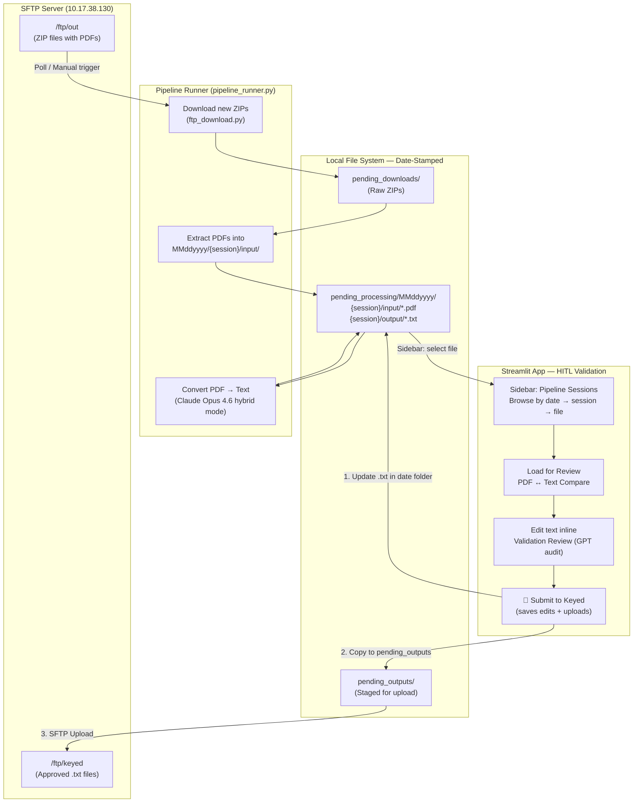
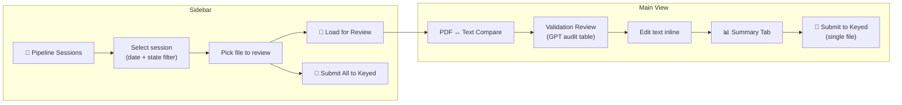

# LCPR Pending Legislation — End-to-End Pipeline

## Overview

Automated pipeline for downloading legislative PDF bills from SFTP, converting them to tagged text using Claude Opus 4.6, and uploading approved outputs back to the SFTP server after human validation (HITL).

---

## Architecture Flow Diagram



---

## Components

| Component | File | Purpose |
|-----------|------|---------|
| SFTP Download | `ftp_download.py` | Connect to SFTP, download new ZIPs to `pending_downloads/` |
| SFTP Upload | `ftp_upload.py` | Upload approved `.txt` files from `pending_outputs/` to `/ftp/keyed` |
| Pipeline Runner | `pipeline_runner.py` | Orchestrates download → extract → convert flow |
| Conversion Engine | `Opus4.6/Claude_Opus_4.6_Test.py` | Claude Opus 4.6 visual/hybrid PDF-to-text conversion |
| Streamlit App | `app/streamlit_app.py` | HITL validation UI with Pipeline Sessions sidebar |
| Session Manager | `app/session_manager.py` | UUID-based session isolation and file tracking |

---

## Detailed Step-by-Step Flow

### Step 1: Download (Automated)

```
SFTP /ftp/out → pending_downloads/
```

- ZIP files arrive on SFTP at `/apps/Codes/MP2/LandingStrips/LCPR/ftp/out`
- Naming pattern: `{STATE}_{GUID}_keying.zip` (e.g., `NC_I8B7124A..._keying.zip`)
- Each ZIP contains one or more PDF legislative bills
- **Trigger:** Manual run or polling daemon (`--poll --interval 5`)
- **Skip logic:** Already-downloaded files are skipped (exists check)

### Step 2: Extract & Detect State

```
pending_downloads/*.zip → pending_processing/MMddyyyy/{session}/input/*.pdf
```

- Creates a **date-stamped folder** (`MMddyyyy` format, e.g., `06232026/`)
- Inside, creates a session folder: `{STATE}_{timestamp}_{zip_stem}`
- PDFs extracted into `input/` subfolder within the session
- State code auto-detected from ZIP filename prefix (`NC_`, `DE_`, `OH_`, etc.)
- Tracks processed ZIPs in `.processed_files.json` to avoid re-processing
- Both input PDF and output text co-located in the same session for HITL traceability

### Step 3: Convert (Automated)

```
pending_processing/MMddyyyy/{session}/input/*.pdf → .../output/*.txt
```

- Each PDF converted using Claude Opus 4.6 in **hybrid mode**:
  - PyMuPDF extracts raw text with formatting detection
  - Claude cleans and applies markup tags: `[A>...<A]` (additions), `[D>...<D]` (deletions)
- State-specific prompts and rules applied automatically
- Deterministic post-processing cleanup runs after LLM output
- Output saved as `.txt` in session's `output/` subfolder

### Step 4: Human Validation — HITL (Manual)

```
Streamlit Sidebar → Select Session → Load File → Review → Edit
```

- User opens Streamlit app (port 8501)
- **Sidebar "Pipeline Sessions"** shows all sessions grouped by date folder
  - Displays: `[MMddyyyy] STATE | N PDFs | N converted`
  - User selects a session and picks a file
- **"Load for Review"** loads the converted text into the main validation UI
  - Source PDF auto-linked for side-by-side comparison
  - State auto-detected from session folder name
- **Validation Review** tab shows GPT audit results (pass/warn/error)
- User can **edit text inline** to fix any issues
- Content accuracy score shown (target: ≥99%)

### Step 5: Submit to Keyed (Manual trigger)

```
User approves → text file updated → pending_outputs/ → SFTP /ftp/keyed
```

Two submit paths available:

**A. From Summary Tab** (single file after full processing):
- User clicks **"🚀 Submit to Keyed"** button in the Summary tab
- Any HITL edits are **saved back to the .txt file** in the date folder
- File copied to `pending_outputs/` (local staging)
- File uploaded via SFTP to `/ftp/keyed`

**B. From Sidebar** (batch submit from pipeline session):
- User clicks **"🚀 Submit All to Keyed"** in the sidebar
- All converted files in the selected session are uploaded
- No edits applied (files submitted as-is from `output/` folder)

Post-submission:
- Downstream systems pick up from `/ftp/keyed` for further processing
- Original PDF + final text remain in the date-stamped folder for audit trail

---

## Pipeline Runner Commands

```bash
# Full pipeline: download + extract + convert
python pipeline_runner.py

# Polling daemon (checks every 5 minutes)
python pipeline_runner.py --poll --interval 5

# Download only (no conversion)
python pipeline_runner.py --download-only

# Convert already-downloaded files
python pipeline_runner.py --convert-only

# List pending sessions ready for review
python pipeline_runner.py --list-sessions

# Manually submit specific files to /ftp/keyed
python pipeline_runner.py --submit file1.txt file2.txt
```

---

## File Naming Convention

| Stage | Pattern | Example |
|-------|---------|---------|
| SFTP ZIP | `{STATE}_{GUID}_keying.zip` | `NC_I8B7124A0659011F1..._keying.zip` |
| Date Folder | `MMddyyyy` | `06232026` |
| Session Folder | `{STATE}_{timestamp}_{zip_stem}` | `NC_20260623_133316_NC_I8B7124A0659011F1` |
| Extracted PDF | `{year}_{year}_{fields}_{date}_{ver}.pdf` | `2025_2026_33_3_6_001085_52_4_1_20260602_0.pdf` |
| Converted TXT | `{same_stem}.txt` | `2025_2026_33_3_6_001085_52_4_1_20260602_0.txt` |

---

## Directory Structure

```
Pending_Legislation/
├── ftp_download.py          # SFTP download script
├── ftp_upload.py            # SFTP upload script
├── pipeline_runner.py       # Orchestrator
├── .env                     # FTP_PASSWORD (gitignored)
├── pending_downloads/       # Raw ZIPs from SFTP
│   ├── NC_I8B7124A..._keying.zip
│   ├── DE_I7475275..._keying.zip
│   └── ...
├── pending_processing/      # Date-stamped processing folders
│   ├── 06232026/            # ← Today's date (MMddyyyy)
│   │   ├── NC_20260623_133316_.../
│   │   │   ├── input/      # Source PDFs
│   │   │   │   └── 2025_2026_33_3_6_001085_52_4_1_20260602_0.pdf
│   │   │   └── output/     # Converted text (updated on HITL submit)
│   │   │       └── 2025_2026_33_3_6_001085_52_4_1_20260602_0.txt
│   │   └── DE_20260623_.../
│   │       ├── input/*.pdf
│   │       └── output/*.txt
│   └── .processed_files.json
├── pending_outputs/         # Approved files staged for upload
│   └── 2025_2026_33_3_6_001085_52_4_1_20260602_0.txt
└── app/
    └── streamlit_app.py     # UI with Pipeline Sessions sidebar
```

---

## Streamlit UI — HITL Workflow



**Sidebar features:**
- Sessions grouped by date folder (`[06232026] NC | 1 PDFs | 1 converted`)
- File picker dropdown for each session
- "Load for Review" loads file into main validation view
- "Submit All to Keyed" batch-uploads all converted files in session

**Main view features:**
- PDF ↔ Text side-by-side comparison
- Validation Review with audit checklist
- Inline text editing (edits saved back on submit)
- "Submit to Keyed" button saves edits + uploads to SFTP

---

## Configuration

| Variable | Source | Default |
|----------|--------|---------|
| `FTP_PASSWORD` | `.env` or environment | *(required)* |
| `DOWNLOAD_DEST_DIR` | environment | `pending_downloads/` |
| `UPLOAD_SOURCE_DIR` | environment | `pending_outputs/` |
| SFTP Host | hardcoded | `10.17.38.130:22` |
| SFTP User | hardcoded | `mag2ftp` |
| Download path | hardcoded | `/apps/Codes/MP2/LandingStrips/LCPR/ftp/out` |
| Upload path | hardcoded | `/apps/Codes/MP2/LandingStrips/LCPR/ftp/keyed` |

---

## Deployment

The app runs in a Docker container deployed via ECR:

1. **Build:** `docker build -t pending_legislation:<VERSION> .`
2. **Push to ECR:** Tag and push to `127288631409.dkr.ecr.us-east-1.amazonaws.com/...`
3. **Streamlit UI** runs on port 8501 inside the container
4. **Pipeline Runner** can run as:
   - A sidecar process in the same container
   - A separate scheduled task / cron job
   - Manually triggered via CLI
