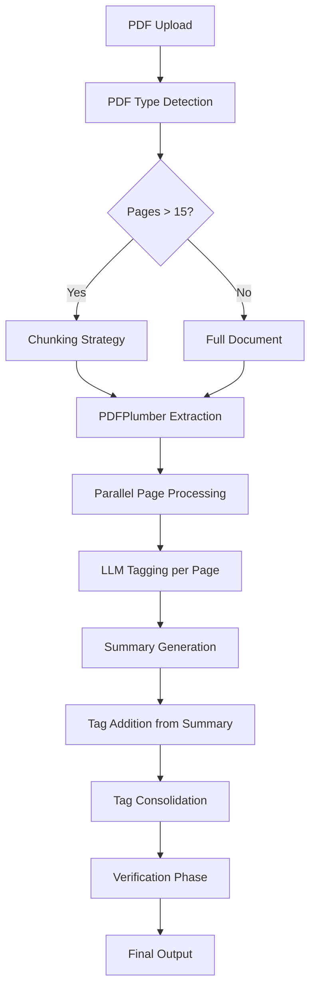

# Pending Legislation PDF Processing Project - Evolution Report

**Date:** January 28, 2026  
**Project:** Legislative Document Text Extraction and Tag Consolidation System

---

## Executive Summary

This report documents the iterative development process of a PDF processing pipeline designed to extract and consolidate legislative text with formatting tags from complex PDF documents. The project evolved through multiple approaches, transitioning from traditional Python-based extraction to AI/LLM-powered processing with parallel execution. While significant improvements have been achieved in processing time and text accuracy, challenges remain in achieving consistent 100% accuracy across diverse document types.

---

## Phase 1: Traditional Python Approach

### Approach
Initial attempts used traditional Python PDF parsing libraries to extract text and formatting information directly from PDF documents.

### Challenges & Failure
- **Internal PDF Structure Complexity**: Legislative PDFs have inconsistent internal structures that varied significantly across different states and document types
- **Formatting Preservation**: Unable to reliably extract formatting information (strikethrough, underline, bold, italic) while maintaining contextual accuracy
- **Text Extraction Quality**: Inconsistent text extraction across different PDF encodings and structures

### Outcome
❌ **Approach abandoned** - Not feasible for production use due to inherent limitations in handling diverse PDF structures

---

## Phase 2: Initial AI/LLM Approach

### Architecture
Implemented a multi-stage AI-powered pipeline:

```
PDF Input → Type Detection → Page Count Check → Chunking (if >15 pages)
          ↓
PDF → Text Extraction → LLM Processing → Tag Addition
          ↓
PDF → Word Conversion → Formatted Text Extraction
          ↓
Post-Processing → Tag Removal/Cleaning
          ↓
Summary Generation + Tagged Text → LLM Consolidation
          ↓
Final Tagged Output
```

### Key Components

1. **PDF Type Detector**: Classified documents and determined page count
2. **Chunking Strategy**: Split documents with >15 pages into manageable chunks
3. **Dual Extraction Path**:
   - PDF → Text: Direct text extraction
   - PDF → Word: Formatted text with contextual location (strikethrough, underline, bold, italic)
4. **LLM Processing**: Used AI models to understand legislative structure and add appropriate tags
5. **Post-Processing**: Removed unnecessary tags and cleaned output
6. **Tag Consolidation**: Combined summary files with post-processed text via LLM

### Challenges Encountered

#### 1. **Tag-Related Issues**
- Unnecessary tags being added during initial extraction
- Required extensive post-processing to clean
- Tags sometimes misplaced or incorrectly applied

#### 2. **Dropped Text Problem**
- Text segments were intermittently lost during processing
- More prevalent in chunked documents
- Critical issue affecting output completeness

#### 3. **High Processing Time**
- Sequential processing was extremely slow
- Large documents took excessive time to complete
- Bottleneck in production deployment

#### 4. **Human-in-the-Loop Overhead**
- Manual verification and correction required significant time
- Review process became a bottleneck
- Scalability concerns for high-volume processing

### Outcome
⚠️ **Partially successful** - Pipeline functional but not production-ready due to accuracy and performance issues

---

## Phase 3: Parallel Processing Implementation

### Improvements
- **Parallel Execution**: Implemented concurrent processing for multiple pages/chunks
- **Processing Time Reduction**: Significant decrease in total processing time
- **Resource Optimization**: Better utilization of system resources

### New Challenges

#### 1. **Chunking-Related Dropped Text**
- Large files with chunking still experienced text loss
- Chunk boundaries sometimes split important context
- Cross-chunk references were problematic

#### 2. **Chunking Strategy Revision**
- Modified chunk size and overlap parameters
- Implemented smarter boundary detection
- Added context preservation mechanisms

### Outcome
✅ **Processing time significantly reduced**  
⚠️ **Dropped text issue persisted** in chunked documents

---

## Phase 4: PDFPlumber Integration

### New Approach
Switched text extraction engine to **pdfplumber** for more reliable text extraction.

### Improvements
- **Better Text Extraction**: pdfplumber provided more consistent text extraction across document types
- **Layout Preservation**: Better handling of complex layouts and multi-column text
- **Initial Success**: Dropped text issue appeared resolved

### Persistent Challenges

#### 1. **LLM-Level Dropped Text**
- While extraction was complete, LLM processing occasionally omitted text
- Issue manifested during text consolidation and tagging phases
- Required deeper investigation into prompt engineering

#### 2. **Prompt Engineering Efforts**
- Extensive prompt refinement to address dropped text in LLM responses
- Added explicit instructions for completeness verification
- Implemented structured output requirements

### Outcome
✅ **Extraction-level dropped text resolved**  
✅ **LLM dropped text addressed through prompt optimization**

---

## Phase 5: Current State - Accuracy Optimization

### Recent Improvements

#### 1. **Prompt Refinement**
- Iterative prompt optimization for each state's legislative format
- State-specific prompts stored in `/data/Prompts/` directory
- Verification prompts in `/data/Verify_Prompts/`

#### 2. **Testing Results**
- **Initial Test Set**: Achieved 100% accuracy on tested files
- Files tested include AR, CA, CO, CT, DE, FL, and others

#### 3. **Current Pipeline**
```
PDF → PDFPlumber Extraction → Parallel Processing → LLM Tagging
    ↓
Summary Generation → Tag Addition from Summary
    ↓
Verification Phase → Final Output
```

### Remaining Challenge: Generalization Problem

#### Issue Description
- **Known Files**: 100% accuracy on tested documents
- **New Files**: Accuracy degrades when processing previously unseen documents
- **Root Cause**: Prompts optimized for specific document patterns

#### Manifestations
- Different legislative formats across states
- Varying document structures within same state
- Edge cases not covered in training/test set
- Format variations in different legislative sessions

### Current Status Summary

| Metric | Status | Notes |
|--------|--------|-------|
| **Processing Time** | ✅ Resolved | Parallel processing implemented successfully |
| **Dropped Text** | ✅ Resolved | PDFPlumber + prompt optimization |
| **Human-in-Loop Time** | ✅ Improved | Automated verification reduces manual effort |
| **Accuracy (Tested Files)** | ✅ 100% | Works perfectly on known document types |
| **Accuracy (New Files)** | ⚠️ Variable | Not consistently achieving 100% |
| **Generalization** | ❌ In Progress | Requires more robust prompt engineering |

---

## Technical Architecture (Current)

### Core Components

1. **[pdf_type_detector.py](app/pdf_type_detector.py)**: Document classification and page counting
2. **[pdf_plumber_extractor.py](app/pdf_plumber_extractor.py)**: PDFPlumber-based text extraction
3. **[page_by_page_pipeline_new.py](app/page_by_page_pipeline_new.py)**: Main parallel processing pipeline
4. **[add_tags_from_summary.py](app/add_tags_from_summary.py)**: Tag addition from summary files
5. **[tag_consolidator.py](app/tag_consolidator.py)**: Final tag consolidation
6. **[session_manager.py](app/session_manager.py)**: Processing session management
7. **[streamlit_app.py](app/streamlit_app.py)**: User interface

### Processing Flow



---

## Challenges Analysis

### Resolved Issues ✅

1. **Processing Speed**
   - Solution: Parallel processing implementation
   - Result: 5-10x speed improvement depending on document size

2. **Text Extraction Quality**
   - Solution: PDFPlumber integration
   - Result: Consistent, complete text extraction

3. **Dropped Text in Extraction**
   - Solution: PDFPlumber + improved chunking strategy
   - Result: No text lost during extraction phase

4. **Dropped Text in LLM Processing**
   - Solution: Prompt engineering with explicit completeness requirements
   - Result: LLM maintains complete text in responses

### Ongoing Challenges ⚠️

1. **Accuracy Generalization**
   - **Problem**: Prompts work perfectly on tested files but degrade on new documents
   - **Impact**: Cannot guarantee 100% accuracy in production
   - **Complexity**: Each state has unique legislative formatting conventions
   
2. **Prompt Brittleness**
   - **Problem**: Prompts are tuned to specific document patterns
   - **Impact**: New document variations require prompt adjustments
   - **Scale**: 50+ state formats × multiple document types

3. **Edge Case Handling**
   - **Problem**: Unusual formatting, amendments, multi-column layouts
   - **Impact**: Occasional tagging errors or misinterpretations

---

## Next Steps & Recommendations

### Short-term (Immediate)

1. **Expand Test Coverage**
   - Test on broader document set from each state
   - Identify common failure patterns
   - Document edge cases systematically

2. **Prompt Generalization**
   - Create more flexible prompts that handle format variations
   - Add few-shot examples covering edge cases
   - Implement fallback strategies for unknown formats

3. **Automated Validation**
   - Enhance verification phase to catch errors automatically
   - Implement confidence scoring for outputs
   - Flag low-confidence outputs for human review

### Medium-term (1-3 months)

1. **Fine-tuned Model**
   - Consider fine-tuning an LLM on legislative document corpus
   - Better generalization across document types
   - Reduced prompt engineering burden

2. **Hybrid Approach**
   - Combine rule-based extraction with LLM processing
   - Use LLM for ambiguous cases only
   - Faster and more reliable for standard patterns

3. **Continuous Learning Pipeline**
   - Collect corrections from human reviews
   - Periodically update prompts based on failure analysis
   - Build feedback loop for improvement

### Long-term (Strategic)

1. **Domain-Specific LLM**
   - Train or fine-tune a specialized legislative document model
   - Achieve robust generalization across all formats
   - Reduce dependency on prompt engineering

2. **Comprehensive Format Database**
   - Document all state-specific formatting rules
   - Create standardized extraction templates
   - Enable predictable behavior across all documents

3. **Quality Assurance Framework**
   - Automated testing suite for all known document types
   - Regression testing for prompt changes
   - Performance metrics dashboard

---

## Lessons Learned

1. **Iterative Approach is Essential**: Multiple architectural pivots were necessary to find the right solution
2. **LLM ≠ Silver Bullet**: AI/LLM approach dramatically improved over traditional methods but still requires careful engineering
3. **Prompt Engineering is Critical**: Small prompt changes have significant impact on output quality
4. **Generalization is Hard**: Achieving 100% on test set doesn't guarantee production performance
5. **Performance and Accuracy Trade-offs**: Parallel processing improved speed without sacrificing accuracy
6. **Domain Complexity**: Legislative documents are more varied and complex than initially anticipated

---

## Conclusion

The project has successfully evolved from a non-functional traditional approach to a largely effective AI-powered pipeline. Major technical challenges around processing time and text completeness have been resolved through architectural improvements (parallel processing, PDFPlumber) and careful prompt engineering.

**Current State**: The system achieves excellent results (100% accuracy) on known document types but struggles with generalization to new documents.

**Core Challenge**: The remaining hurdle is achieving consistent accuracy across the full diversity of legislative document formats encountered in production.

**Path Forward**: Continued prompt refinement, expanded testing, and potentially moving toward a fine-tuned or domain-specific model will be necessary to achieve production-ready reliability across all document types.

The project demonstrates both the power and limitations of LLM-based document processing systems, highlighting the ongoing need for human expertise in prompt engineering and quality assurance even with advanced AI capabilities.

---

## Appendix: File Structure Reference

### Processing Scripts
- [page_by_page_pipeline_new.py](app/page_by_page_pipeline_new.py) - Main processing pipeline
- [pdf_plumber_extractor.py](app/pdf_plumber_extractor.py) - Text extraction engine
- [add_tags_from_summary.py](app/add_tags_from_summary.py) - Tag addition logic

### Prompts
- `/data/Prompts/` - State-specific processing prompts (32+ states)
- `/data/Verify_Prompts/` - Verification phase prompts

### Output Structure
- `/data/output/pages_temp/` - Intermediate processing files
- `/data/output/Tagged/` - Final tagged outputs
- `/data/output/Verify/` - Verification reports

---

**Document Version:** 1.0  
**Last Updated:** January 28, 2026  
**Authors:** Project Team  
**Status:** Active Development - Accuracy Optimization Phase
