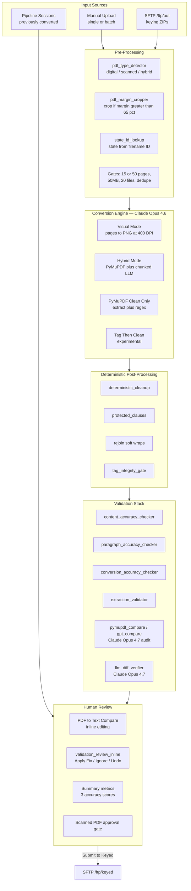
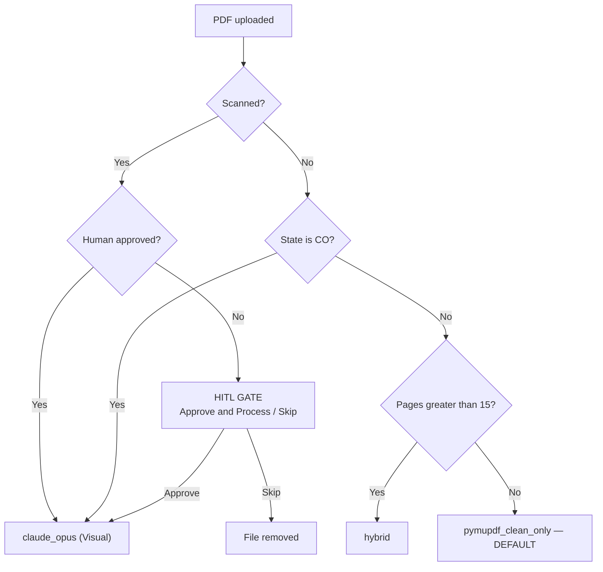
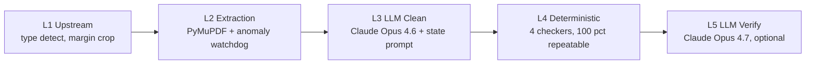

# Streamlit Application — Complete Feature Reference

> Snapshot of the Pending Legislation Streamlit application as of 2026-10-06.
> Compiled as a baseline reference for the React/FastAPI migration evaluation.

---

## 1. High-Level Architecture

---

## 2. Processing Mode Routing

Six modes exist; the application selects one automatically.

| Mode | Trigger | Engine |
|---|---|---|
| `claude_opus` | Scanned PDF, or CO state | Page images → Claude Opus 4.6 |
| `hybrid` | > 15 pages | PyMuPDF + chunked LLM clean |
| `pymupdf_clean_only` | ≤ 15 pages (default) | PyMuPDF + regex |
| `tag_then_clean` | Optional / experimental | Tag first, then clean |
| `pdfplumber` | Legacy (disabled) | pdfplumber extraction |
| `vision` | Fallback | Legacy |

Routing logic lives in `app/streamlit_app.py` (`show_single_file_processing`, approx. lines 8211–8310).

---

## 3. Complete Feature Inventory

### A. Input & Upload

**Three input modes** (horizontal radio selector):

1. **Upload PDF Files** — single or multi-file via `st.file_uploader`
2. **Downloaded Files** — SFTP ZIP browser, "Check SFTP for New Files", "Extract & Convert"
3. **Pipeline Sessions** — browse previously converted sessions grouped by date

**Upload validation gates:**

| Gate | Value | Notes |
|---|---|---|
| Page limit (standard) | 15 | `MAX_PAGES` |
| Page limit (vision) | 50 | `MAX_PAGES_VISION` — scanned PDFs, CO state |
| Total batch size | 50 MB | env `BATCH_MAX_TOTAL_SIZE_MB` |
| Max batch files | 20 | `MAX_BATCH` |
| Duplicate detection | — | key = `filename_filesize` |

Page limits are enforced for batch uploads only; single files bypass them.

**PDF type detection** runs at upload time and displays:
`N pages detected — Type: Digital / Scanned / Hybrid (text + images)`

### B. Processing & Live Feedback

- **Pipeline step tracker** — grid of step cards with status: Completed, Warnings, Failed, Running, Pending
- **Two-phase display** — Phase 1 Conversion (5 steps), Phase 2 Validation (3 steps)
- **Activity Log** — live timestamped feed, colour-coded by level (info / success / warning / error), scrollable to 760px
- **Processing pill** — compact status line with filename, state, and progress
- **Batch mode** — progress bar, per-file index, background `BatchWorker` daemon thread

### C. Results — Three Tabs

#### PDF ↔ Text Compare

- Side-by-side PDF pages and converted text
- Word-level bounding-box mapping between PDF words and text words
- OCR fallback via Tesseract for scanned pages
- Inline text editing, saved back to the output file
- Edits are included when submitting to keyed
- Alternative viewers available: `pdf_draftable_compare` (line-level diff), `pdf_text_diff` (content-based page sync)

#### Summary

Three accuracy scores, each colour-coded green / amber / red:

| Metric | Source |
|---|---|
| Content Accuracy % | `content_accuracy_checker` — word-level preservation |
| Tag Accuracy % | LLM audit checklist pass rate |
| Layout Accuracy % | `paragraph_accuracy_checker` — paragraph boundary fidelity |

Also displayed: conversion time, validation time, output size, total time, state pill.

Expandable issue tables:

- **Tag Issues** — Status, Page, Line, Text, Issue, Suggested Fix
- **Layout Issues** — split-needed / merge-needed paragraph breaks
- **Content Issues** — Missing / Extra / Substitution words

Plus the **Submit to Keyed** action.

#### Activity Log

Full run history for the processed file.

### D. Validation Review (HITL)

Implemented in `app/validation_review_inline.py`:

- Metric cards (pass / warn / error counts)
- Sticky, clickable checklist table
- Detail pane showing Claude text vs expected PDF text vs surrounding context
- **Apply Fix** — targeted single replacement written to the `.txt` output
- **Ignore** — mark as false positive, removing it from the error count
- **Undo** — revert with before/after preview
- Per-file state persistence and error navigation

### E. Sidebar

- Session info: ID, status, created timestamp (local/dev deployments only)
- System stats: active and processing session counts
- **LLM-verify residual text diffs** toggle — one Claude Opus 4.7 call per bill
- **New Session** — full state reset and disk cleanup

### F. Output & Delivery

- Submit a single reviewed file to `/ftp/keyed`
- Submit All — bulk submit from a pipeline session
- Downloaded Files flow: extract ZIPs, convert, auto-upload
- Upload logging via the session manager

---

## 4. The Five-Layer Validation Stack

| Layer | Modules | Uses LLM |
|---|---|---|
| L1 Upstream | `pdf_type_detector`, `pdf_margin_cropper` | No |
| L2 Extraction | `pymupdf_extractor`, `extraction_validator` | No |
| L3 Clean | `Claude_Opus_4.6_Test` + 20 state prompts | Claude Opus 4.6 |
| L4 Deterministic | `content_accuracy_checker`, `paragraph_accuracy_checker`, `conversion_accuracy_checker`, `compare_files`, `protected_clauses` | No |
| L5 Verify | `gpt_compare`, `pymupdf_compare`, `llm_diff_verifier` | Claude Opus 4.7 |

### L5 safety policy (important)

An LLM may only **demote** a flagged difference to "expected" when **all** of the following hold:

- verdict is `artifact`
- confidence is `high`
- category is one of: `header`, `footer`, `decorative_rule`, `page_number`
- word count ≤ 15

The LLM can **never promote** an allowed difference back to a real difference. This asymmetry is deliberate and must be preserved in any rewrite.

---

## 5. Module Map

Approximately 25 modules.

| Area | Modules |
|---|---|
| UI | `streamlit_app.py` (~8.9k lines), `validation_review_inline.py`, `summary_ui_demo.py` |
| Extraction | `pymupdf_extractor.py` (~9k lines), `pdf_type_detector.py`, `pdf_margin_cropper.py` |
| Conversion | `Claude_Opus_4.6_Test.py` (~4.8k lines), 20 state prompts in `data/Prompts/` |
| Validation | `content_accuracy_checker`, `paragraph_accuracy_checker`, `conversion_accuracy_checker`, `extraction_validator`, `compare_files`, `text_accuracy_helpers` |
| LLM Audit | `gpt_compare.py`, `pymupdf_compare.py`, `llm_diff_verifier.py` |
| Viewers | `pdf_compare_viewer`, `pdf_draftable_compare`, `pdf_text_diff` |
| Infrastructure | `session_manager`, `pipeline_runner`, `ftp_download`, `ftp_upload`, `state_id_lookup`, `protected_clauses` |

### Models in use

| Component | Model |
|---|---|
| Conversion (visual, hybrid, state detection) | `claude-opus-4-6` |
| `gpt_compare.py` audit | `claude-opus-4-7` |
| `pymupdf_compare.py` audit | `claude-opus-4-7` |
| `llm_diff_verifier.py` | `claude-opus-4-7` |

---

## 6. State-Specific Handling

| State | Behaviour |
|---|---|
| CO | Always routed to Visual mode; validation pipeline skipped |
| AR | Page-1 header preservation; enacting/resolving clause soft-wrap guard |
| IA | Page-1 header preservation, same pattern as AR |
| FL | Terminal-punctuation guard prevents welding separate underlined paragraphs; column-aligned table layout rules |
| CT | Pre-LLM bracket tagging, tag-boundary lock, multiple deterministic fixes |
| KS, DE, IN, CA | Protected clauses — boilerplate that must never carry tags |

---

## 7. Environment Variables

| Variable | Default | Purpose |
|---|---|---|
| `FTP_PASSWORD` | required | SFTP authentication |
| `APP_TMP_DIR` | `./tmp/` | Session and output directory |
| `BATCH_MAX_TOTAL_SIZE_MB` | 50 | Total batch upload limit |
| `DOWNLOAD_DEST_DIR` | `tmp/pending_downloads` | SFTP download destination |
| `UPLOAD_SOURCE_DIR` | `tmp/pending_processing` | SFTP upload source |
| `VISUAL_CHUNK_PAGES` | 15 | Pages per visual-mode API request |

---

## 8. Coverage Comparison — React Trial

Status of the `webapp_trial/` prototype relative to the Streamlit application.

| Feature | Streamlit | React trial |
|---|---|---|
| Upload and convert | Yes | Yes |
| State auto-detect | Yes | Yes |
| PDF/text side-by-side | Yes, word-level | Basic |
| Six processing modes | Yes | Hybrid only |
| Scanned HITL gate | Yes | No |
| Three accuracy scores | Yes | No |
| Validation review, Apply Fix, Undo | Yes | No |
| Batch processing | Yes | No |
| Pipeline sessions | Yes | No |
| SFTP submit | Yes | No — local save only, by design |
| Inline editing | Yes | No |

The trial covers roughly 15% of the feature surface. All business logic in layers L1–L5 is reusable without modification; the migration cost is concentrated in the approximately 9,000 lines of UI code.

---

## 9. Known Issues (from the Florida go-live review)

Recorded 2026-10-05, not yet fixed.

1. **Accuracy always logs 0%** — `app/pipeline_runner.py` reads `content_report.get("accuracy", 0)`, but `check_content_accuracy()` returns `accuracy_pct`. The fallback makes every pipeline run report 0%.
2. **Wrong input to accuracy check** — raw PyMuPDF text is passed where pre-cleaned text is expected, inflating missing/extra word counts.
3. **Production runner skips integrity steps** — `strip_protected_tags`, `rejoin_mid_sentence_line_breaks`, `enforce_tag_integrity_gate`, and `build_tag_integrity_report` all run in the Streamlit path but not in `app/pipeline_runner.py`. The documented `*_integrity_validation.json` artifact is therefore never produced by the automated pipeline.
4. **SFTP host labelled UAT** — `10.17.38.130` is hardcoded in five locations with "UAT" docstrings, while the image deploys to a `-prod` ECR repository. No environment override exists for host or remote path.
5. **Committed credential** — `config/pdfservices-api-credentials.json` holds a live Adobe client ID and secret, and the Dockerfile copies it into the image. Rotation and secret-store migration recommended.
6. **FL has no protected clauses** — unlike KS, DE, IN, and CA, Florida boilerplate has no guard against being tagged.
7. **SSL verification disabled on the Claude auth path** — `verify=False` and `urllib3.disable_warnings(...)` in `Opus4.6/Claude_Opus_4.6_Test.py` (token request and HTTP client) and `Opus4.6/gpt_compare.py`. Likely a workaround for a TLS-inspection proxy; should be a signed-off decision with an internal CA certificate rather than an inherited default.
8. **Deployment documentation is stale** — recorded 2026-10-06. The live deployment is at
   `https://aideployment-prod.plexus.gcs.int.thomsonreuters.com/208321/pending_legislationv2/`,
   but `DEPLOYMENT_COMMANDS_2026-06-11.md` still records `.../208321/pending_legislation/` and
   `Current latest version: 3.1.1`. Open items: which image tag is running as v2, whether the
   v1 path is still live (risk of double-processing the same `/ftp/out` queue), and what the
   rollback target is.
9. **No Florida regression tests** — `tests/fixtures/` contains only Arkansas and Delaware bills. FL-specific logic (terminal-punctuation guard, column-aligned table rules) has no snapshot coverage despite FL being the next state to go live.

---

## 10. Related Documents

| Document | Purpose |
|---|---|
| `PIPELINE_FLOW.md` | End-to-end SFTP pipeline description |
| `PENDING_LEGISLATION_HANDOFF_GUIDE.md` | Operational handoff guide |
| `DEPLOYMENT_COMMANDS_2026-06-11.md` | Docker build, ECR tag and push steps |
| `README.md` | Project overview |
